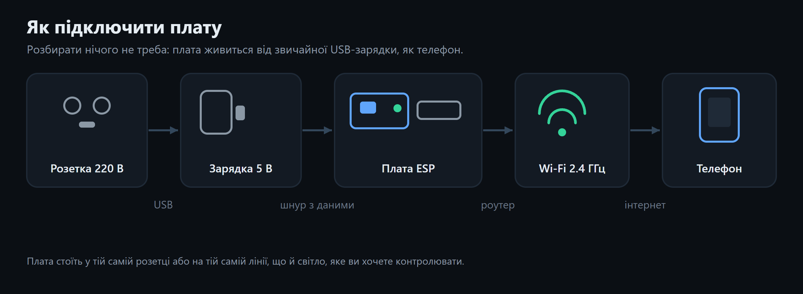
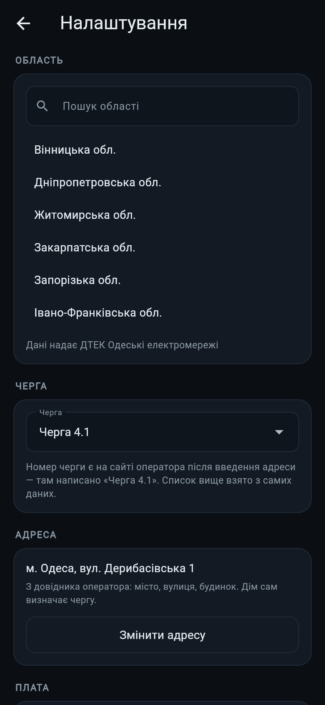
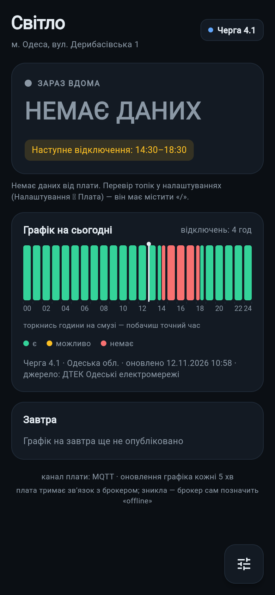
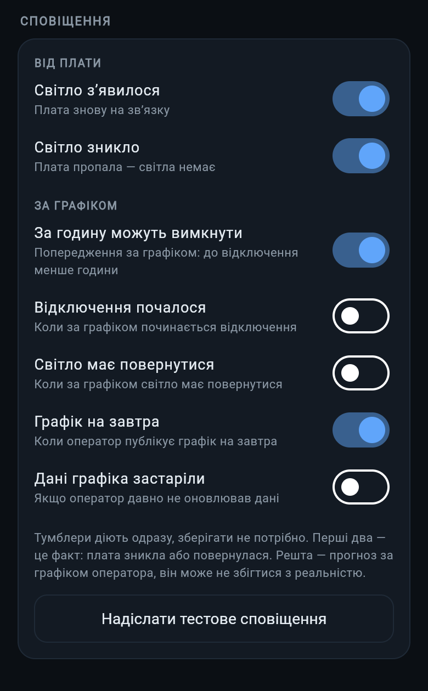
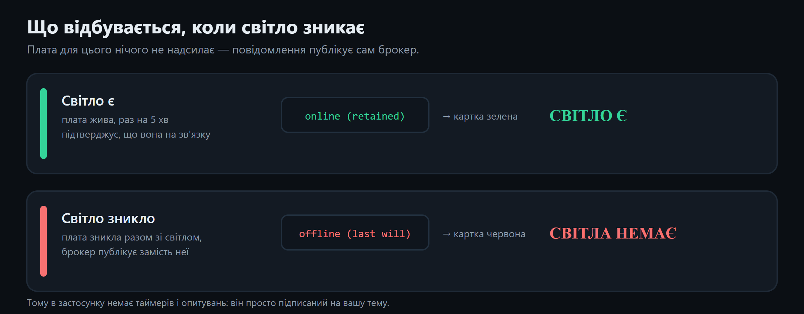

# Світло

Плата в розетці + застосунок на телефоні. Застосунок показує **чи є світло
насправді** (за цією платою, а не за новинами) і поруч — **графік відключень**
для вашої області й черги.

Ніяких серверів, акаунтів і платних підписок: плата сама повідомляє стан через
публічний MQTT-брокер, а графік застосунок бере з відкритих джерел.

---

## Що знадобиться

| Що | Варіанти | Примітка |
|---|---|---|
| Плата | **ESP8266**: Wemos D1 mini, NodeMCU V3 | найдешевший варіант, ~3–5 $ |
| | **ESP32**: DevKit V1 / WROOM-32, ESP32-C3, ESP32-S3 | якщо вже є під рукою |
| Кабель | micro-USB або USB-C — **не «тільки зарядка»** | потрібен кабель із лініями даних, інакше комп'ютер не побачить плату |
| Живлення | будь-яка зарядка 5 В, від 0.5 А | звичайна телефонна |
| Wi-Fi | **тільки 2.4 ГГц** | 5 ГГц плата не бачить |
| Телефон | Android 8 або новіший | для застосунку |

Розбирати нічого не треба і 220 В чіпати не потрібно: плата живиться від
USB-зарядки, як телефон. Вона стоїть у розетці поруч і показує, чи є на ній
живлення.




---

## Потрібний софт

| Що | Навіщо | Де взяти |
|---|---|---|
| Arduino IDE 2.x | прошити плату | arduino.cc/en/software |
| Ядро **ESP8266** (3.x) | підтримка чіпа ESP8266 | Менеджер плат в IDE |
| або ядро **ESP32** (3.x) | підтримка чіпа ESP32 | Менеджер плат в IDE |
| Бібліотека **PubSubClient** (Nick O'Leary) | MQTT-зв'язок з брокером | Менеджер бібліотек в IDE |
| Драйвер **CH340** або **CP2102** | якщо порт плати не з'являється | зазвичай ставиться сам; якщо ні — сайт виробника плати |

Ядро ставиться одне — те, що відповідає вашій платі. Обидва одночасно теж можна.

---

## Крок за кроком

### 1. Встановити Arduino IDE

Завантажити з arduino.cc і встановити як звичайну програму.

### 2. Додати посилання на плати

**File → Preferences → Additional boards manager URLs** (українською:
**Файл → Налаштування → Додаткові посилання для менеджера плат**) і вставити
рядок для свого чіпа:

```
ESP8266:  https://arduino.esp8266.com/stable/package_esp8266com_index.json
ESP32:    https://espressif.github.io/arduino-esp32/package_esp32_index.json
```

Якщо додаєте обидва — розділіть їх комою в одному рядку.

### 3. Встановити ядро плати

**Інструменти → Плата → Менеджер плат**, знайти `esp8266` (або `esp32`) і
натиснути «Встановити». Завантаження велике: ESP8266 ~50 МБ, ESP32 ~1 ГБ.

### 4. Встановити бібліотеку PubSubClient

**Інструменти → Керувати бібліотеками**, у пошуку `PubSubClient`, автор
**Nick O'Leary** → «Встановити».

### 5. Завантажити прошивку

Файл **`svitlo_hb_universal.ino`** лежить у цьому репозиторії (кнопка
«Завантажити прошивку» на сторінці проєкту) — один файл і для ESP8266, і для ESP32.

### 6. Заповнити блок налаштувань

У самому верху файлу, більше нічого чіпати не треба:

```cpp
#define WIFI_SSID   "НАЗВА_МЕРЕЖІ"      // назва вашого Wi-Fi (2.4 ГГц)
#define WIFI_PASS   "ПАРОЛЬ_МЕРЕЖІ"     // пароль від Wi-Fi
#define TOPIC_STATE "svitlo/my-city-xxxxxxxxxxxxxxxxxxxxxxxx/state"
```

**Про топік.** Це адреса вашого каналу, і фактично це пароль: хто знає топік,
той бачить стан вашої оселі й може надіслати неправдиве «світло є». Тому:

- придумайте свій, не копіюйте приклад;
- формат: `svitlo/<місто>-<24 випадкові hex-символи>/state`;
- цей самий рядок потім вставите в застосунку.

### 7. Підключити плату і прошити

1. Під'єднати плату кабелем до комп'ютера (саме кабелем даних).
2. **Інструменти → Плата**: `Wemos D1 mini` для ESP8266, `ESP32 Dev Module` для ESP32.
3. **Інструменти → Порт**: вибрати порт, що з'явився (COM3, COM5…).
4. Натиснути **«Завантажити»** (стрілка вправо).

### 8. Перевірити, що плата на зв'язку

Відкрити **Інструменти → Монітор порту**, швидкість **115200**. Має бути:

```
=== svitlo: старт | чіп 0099F4E0 | вільно 51592 байт ===
wifi ok, ip=192.168.0.102 rssi=-58
mqtt: online (retained)
```

`rc=-2` у перші секунди — нормально, це повторна спроба; головне, щоб з'явився
рядок `online`.

### 9. Встановити застосунок

Завантажити APK зі сторінки проєкту (або з розділу Releases) і встановити.
Android запитає дозвіл на встановлення з невідомого джерела — це нормально для
APK не з Play Market.

### 10. Налаштувати застосунок

**Налаштування** (шестірня в правому нижньому куті):

1. **Область** — почніть вводити назву, список відфільтрується: «од» → Одеська.
2. **Черга** — з позначкою, яка у вас за адресою. Для Одеси можна обрати
   **Адреса → Змінити адресу** і вибрати місто, вулицю й будинок — дім сам
   підставить чергу.
3. **Топік плати** — вставити той самий рядок `TOPIC_STATE`, що в прошивці.
4. **Зберегти**.



### 11. Перевірити кінцевий результат

- На головному екрані картка показує **«СВІТЛО Є»** і графік на сьогодні.
- Висмикніть зарядку плати з розетки — протягом ~30 секунд картка стане
  **«СВІТЛА НЕМАЄ»**. Увімкніть назад — знову «СВІТЛО Є».



Картка має три стани: **СВІТЛО Є**, **СВІТЛА НЕМАЄ** і **НЕМАЄ ДАНИХ** — третій
означає, що плата ще жодного разу не виходила на зв'язок (перевірте топік).

Це і є вся перевірка: якщо обидва стани відпрацювали, датчик працює.

---

## Сповіщення

У налаштуваннях є блок **«Сповіщення»** — сім тумблерів. Діють одразу,
зберігати не потрібно.

| Група | Тумблер | Коли спрацьовує | За замовчуванням |
|---|---|---|---|
| Від плати | Світло з'явилося | плата вийшла на зв'язок | увімкнено |
| Від плати | Світло зникло | плата пропала — світла немає | увімкнено |
| За графіком | За годину можуть вимкнути | до відключення менше години | увімкнено |
| За графіком | Відключення почалося | перші 30 хвилин після межі | вимкнено |
| За графіком | Світло має повернутися | перші 30 хвилин після кінця | вимкнено |
| За графіком | Графік на завтра | оператор опублікував графік на завтра | увімкнено |
| За графіком | Дані графіка застаріли | оператор не оновлював понад 6 годин | вимкнено |



Різниця принципова: перші два — це **факт**, його дає плата. Решта — **прогноз**
за графіком оператора, і він може не збігтися з реальністю. Тому планові
сповіщення за замовчуванням вимкнені, крім попередження «за годину»: краще
дізнатися заздалегідь і зарядити павербанк.

Кожна подія показується один раз — повторів немає ні при перезапуску
застосунку, ні при фоновій перевірці кожні 15 хвилин.

**Перевірити, чи доходять сповіщення:** кнопка «Надіслати тестове сповіщення»
під тумблерами. Вона показує повідомлення незалежно від налаштувань тумблерів —
інакше перевірка не мала б сенсу. Якщо повідомлення не з'явилося, застосунок
прямо скаже, що сповіщення вимкнені в системі: Налаштування Android →
Застосунки → Світло → Сповіщення.


---

## Як це працює



- Плата тримає з'єднання з брокером і публікує **retained** повідомлення
  `online` — тобто «стан на зараз», який брокер зберігає для нових підписників.
- На випадок зникнення плати зареєстрований **last will** `offline`: щойно
  живлення зникає, брокер сам публікує `offline`. Плата для цього не потрібна.
- Застосунок просто підписаний на топік. Тому «немає даних від плати» = немає
  світла, без жодних таймерів і опитувань.

---

## Часті проблеми

| Симптом | Причина | Що робити |
|---|---|---|
| Порт не з'являється | кабель «тільки зарядка» або немає драйвера | інший кабель; поставити драйвер CH340/CP2102 |
| `connect failed rc=-2` постійно | плата не дісталася до брокера | перевірити назву/пароль Wi-Fi і що мережа 2.4 ГГц |
| `rc=-4` | брокер не пускає | перевірити `MQTT_HOST` і що топік не порожній |
| Висить на крапках у моніторі | слабкий сигнал або неправильний пароль | підійти ближче до роутера, перевірити пароль |
| Застосунок пише «НЕМАЄ ДАНИХ ВІД ПЛАТИ» | топік у застосунку не збігається з прошивкою | порівняти посимвольно, без пробілів на початку й в кінці |
| Картка «СВІТЛО Є», але світла немає | плата живиться не з тієї лінії | плата має бути в тій самій розетці/лінії, що й світло |
| Графік порожній | для області немає свіжих даних | застосунок попереджає про застарілі дані; спробувати іншу чергу |

---

## Обмеження, про які варто знати

- **Тільки 2.4 ГГц.** Якщо роутер роздає одну назву і на 2.4, і на 5 ГГц —
  зробіть окрему назву для 2.4 ГГц.
- **Роутер теж зникає під час відключення.** Якщо роутер без безперебійника,
  разом зі світлом зникає і Wi-Fi, тому застосунок бачить «немає даних», а не
  «світла немає». Обидва стани означають те саме на практиці; якщо хочете
  розрізняти — роутер на маленькому UPS.
- **Довідник адрес** (місто → вулиця → будинок із автовизначенням черги) є лише
  для Одеси: інші сайти операторів закриті захистом і не віддають дані
  мобільному застосунку. Для решти областей черга вибирається вручну.
- **Графік — з відкритих дзеркал**, він може відставати від сайту оператора на
  10–30 хвилин. Застосунок показує, коли дані оновлені, і попереджає, якщо вони
  застарілі.
- **Оновлення застосунку** приходить через сам застосунок:
  Налаштування → Оновлення.

---

## Файли проєкту

| Файл | Що це |
|---|---|
| `svitlo_hb_universal.ino` | прошивка плати, ESP8266 + ESP32 |
| `svitlo-*.apk` | застосунок для Android |
| `version.json` | маніфест, за яким застосунок дізнається про оновлення |

Ліцензія та питання — у розділі Issues цього репозиторію.
