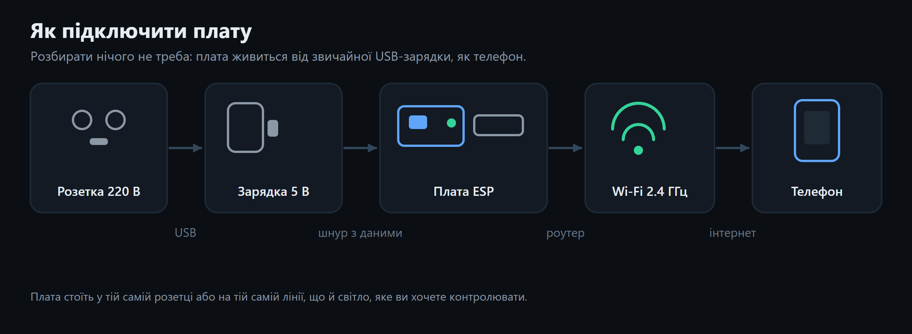
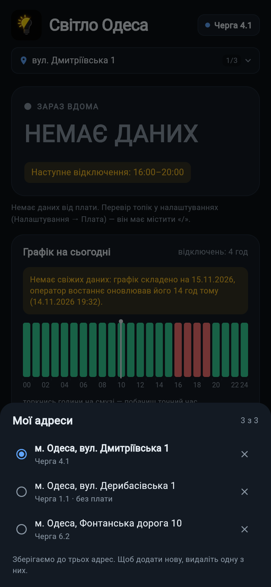
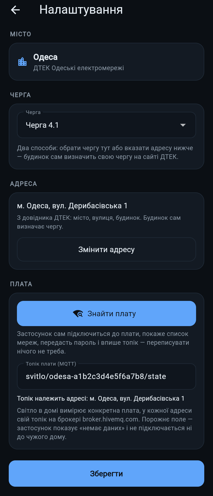
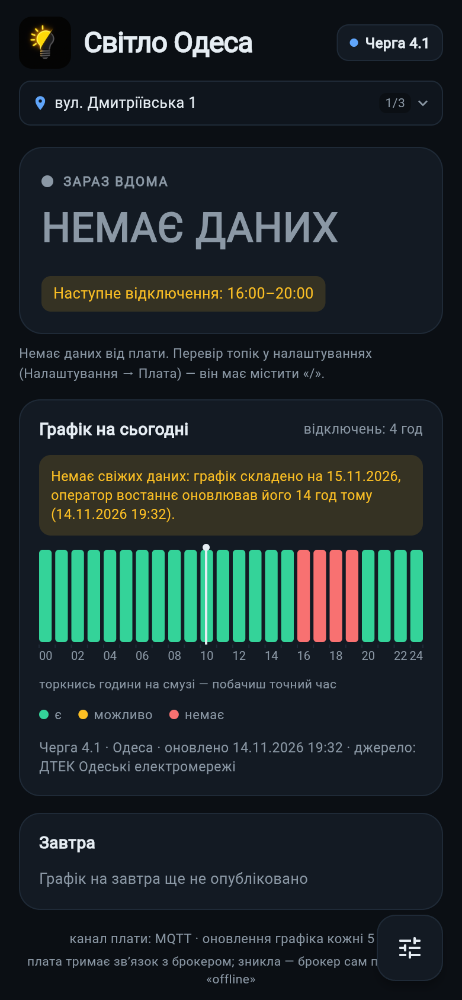
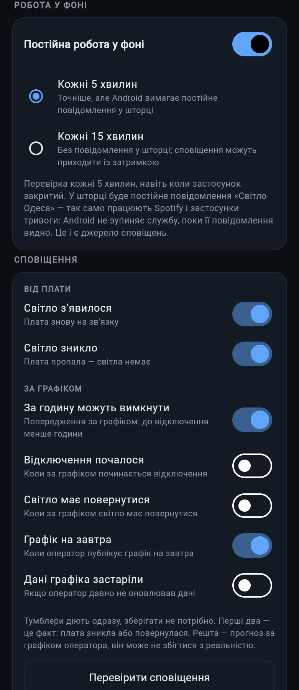
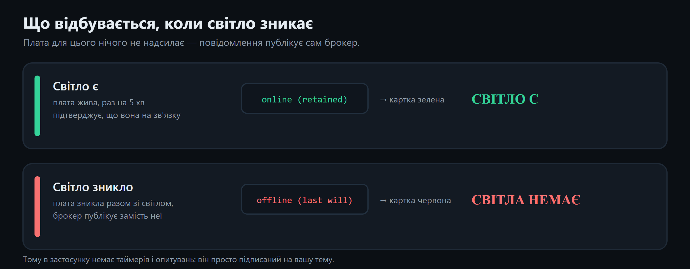

# Світло Одеса

> **Прошити плату** — кнопка на сторінці проєкту:
> https://arsenijdor.github.io/svitlo/flash.html
>
> **Де лежить прошивка:**
> готові файли для заливки — `docs/firmware/` у цьому репозиторії
> (`esp8266/svitlo-esp8266.bin`, `esp32/svitlo-esp32.bin` + `manifest.json`);
> код прошивки — `firmware/svitlo_portal/`. Завантажувати їх вручну не потрібно:
> кнопка вище сама бере потрібний файл і сама визначає чип.
>
> **Сторінка проєкту** (APK, кнопка прошивки, скриншоти) →
> https://arsenijdor.github.io/svitlo/

Плата в розетці + застосунок на телефоні для **Одеси**. Застосунок показує
**чи є світло насправді** (за цією платою, а не за новинами) і поруч —
**графік відключень ДТЕК** для вашої черги.

Ніяких серверів, акаунтів і платних підписок: плата сама повідомляє стан через
публічний MQTT-брокер, а графік застосунок бере з відкритих джерел.

**Прошивка ставиться з браузера — Arduino IDE, тулчейн і редагування коду не
потрібні.** А Wi-Fi плата налаштовує сама: створює власну мережу й показує
сторінку, де ви просто обираєте свою мережу зі списку.

---

## Що знадобиться

| Що | Варіанти | Примітка |
|---|---|---|
| Плата | **ESP8266**: Wemos D1 mini, Wemos D1 R2 (формат УНО), NodeMCU V3 | найдешевший варіант, ~3–5 $ |
| | **ESP32**: DevKit V1 / WROOM-32 | якщо вже є під рукою |
| Кабель | micro-USB або USB-C — **не «тільки зарядка»** | потрібен кабель із лініями даних, інакше комп'ютер не побачить плату |
| Живлення | будь-яка зарядка 5 В, від 0.5 А | звичайна телефонна |
| Wi-Fi | **тільки 2.4 ГГц** | 5 ГГц плата не бачить |
| Телефон | Android 8 або новіший | для застосунку |
| Браузер | **Chrome або Edge** на комп'ютері | лише один раз, щоб прошити плату. У Firefox Web Serial є, але часто падає з «Failed to initialize» |

Розбирати нічого не треба і 220 В чіпати не потрібно: плата живиться від
USB-зарядки, як телефон. Вона стоїть у розетці поруч і показує, чи є на ній
живлення.

---

## Крок за кроком

### 1. Прошити плату з браузера

1. На сторінці проєкту натиснути **«Прошити плату»**.
2. Під'єднати плату кабелем до комп'ютера.
3. У вікні вибору порту вибрати свій (COM3, COM5… на Windows).
4. Натиснути «Встановити» і дочекатися «Готово» — це 20–40 секунд.

Браузер сам визначає чип (ESP8266 чи ESP32) і сам підбирає файл прошивки.
Нічого завантажувати й налаштовувати вручну не треба.

> Якщо кнопка сіра — браузер не вміє Web Serial. Відкрийте сторінку в Chrome
> або Edge. На iPhone це неможливо в принципі, тому прошивка робиться з
> комп'ютера.
>
> **Firefox:** Web Serial у ньому вже є, але керування DTR/RTS інше — плата не
> завжди входить у режим прошивки, і установка падає з «Failed to initialize».
> Якщо все ж пробуєте у Firefox — затисніть кнопку **FLASH** (вона ж BOOT) на
> платі під час натискання «Install».

### 2. Налаштувати плату

Після прошивки плата не знає жодної мережі, тому створює власну —
**`Svitlo-XXXX`**. Далі два шляхи: у застосунку (простіше) або через сторінку
плати в браузері.

**Шлях А — у застосунку (рекомендований).**

1. Встановити застосунок (крок 4 нижче) і відкрити **Налаштування → Плата →
   «Знайти плату»**.
2. У налаштуваннях Wi-Fi телефона підключитися до мережі **`Svitlo-XXXX`**
   (без пароля). Кнопка «Відкрити налаштування Wi-Fi» на екрані відкриє їх
   одразу.
3. Повернутися в застосунок — він сам побачить плату й покаже **список мереж,
   які бачить вона**.
4. Обрати свою мережу (2.4 ГГц), вписати пароль, натиснути **«Підключити
   плату»**.
5. Плата підключиться, а **топік впишеться в налаштування адреси сам** —
   копіювати нічого не треба.

**Шлях Б — через сторінку плати (якщо застосунку під рукою немає).**

1. У телефоні підключитися до **`Svitlo-XXXX`**.
2. Сторінка налаштування відкриється сама. Якщо ні — відкрити
   `http://192.168.4.1` у браузері.
3. Обрати свою мережу зі списку, вписати пароль (є кнопка «Показати пароль»).
4. Натиснути **«Зберегти й підключитися»** і скопіювати топік, який покаже
   плата, у застосунок: **Налаштування → Топік плати (MQTT)**.

Плата перевіряє з'єднання: якщо пароль неправильний, вона не мовчить, а показує
помилку й повертає на ту саму сторінку. Після успіху — перезавантажується вже
як звичайний пристрій у вашій мережі.

> **Поки телефон підключений до мережі плати, інтернету в ньому немає** — це
> нормально, так у всіх розумних пристроїв. Після збереження все повернеться.

### 3. Топік: що це і навіщо

Топік — рядок вигляду `svitlo/odesa-a1b2c3d4e5f6a7b8/state`. Це адреса й
пароль вашої плати одночасно; плата придумує його сама. Хто знає топік, той
бачить стан вашої оселі й може надіслати неправдиве «світло є» — тому не
показуйте його нікому.

Якщо налаштовували через застосунок — він уже вписаний. Якщо через сторінку
плати — вставте його в **Налаштування → Топік плати (MQTT)**.

### 4. Встановити застосунок

Завантажити APK зі сторінки проєкту (або з розділу Releases) і встановити.
Android запитає дозвіл на встановлення з невідомого джерела — це нормально для
APK не з Play Market.

### 5. Налаштувати застосунок

**Налаштування** (шестірня в правому нижньому куті). Місто вже фіксоване —
Одеса, обирати область не потрібно. Чергу можна задати **двома способами**:

1. **За чергою** — обрати номер зі списку. Список приходить із реальних даних
   ДТЕК, тому зайвих черг там немає.
2. **За адресою** — «Адреса → Змінити адресу», вибрати вулицю й будинок.
   **Будинок сам визначає свою чергу** на сайті ДТЕК і підставляє її.

**До трьох адрес.** Під назвою застосунку є рамка з поточною адресою — натисніть
її, щоб відкрити список. У списку можна перемкнутися на іншу адресу, додати нову
(«Додати адресу», максимум три) або прибрати зайву хрестиком. Черга, графік і
сповіщення одразу перераховуються під обрану адресу. Біля кожної адреси видно, чи
прив'язана до неї плата: «без плати» означає, що топік не вписали й картка стану
показуватиме «немає даних».

> **У кожної адреси своя плата.** Плата стоїть у конкретній квартирі, тому й
> топік свій у кожної адреси: перемкнули адресу — застосунок підключається до
> плати цієї адреси, а якщо її немає, чесно показує «немає даних», а не стан
> чужої оселі. Топік належить тій адресі, яка зараз обрана: під полем так і
> написано.

### 6. Перевірити кінцевий результат

- На головному екрані картка показує **«СВІТЛО Є»** і графік на сьогодні.
- Висмикніть зарядку плати з розетки — протягом ~30 секунд картка стане
  **«СВІТЛА НЕМАЄ»**. Увімкніть назад — знову «СВІТЛО Є».

Картка має три стани: **СВІТЛО Є**, **СВІТЛА НЕМАЄ** і **НЕМАЄ ДАНИХ** — третій
означає, що плата ще жодного разу не виходила на зв'язок (перевірте топік).

Це і є вся перевірка: якщо обидва стани відпрацювали, датчик працює.

---

## Сповіщення

Спочатку в налаштуваннях є головний вимикач — **«Постійна робота у фоні»**. Це те,
що взагалі дозволяє застосунку дізнатися про зміну, коли він закритий: раз на
**5 хвилин** він перевіряє плату й графік.

Працює так само, як Spotify чи застосунки тривоги: поки робота в фоні
увімкнена, у шторці висить постійне повідомлення **«Світло Одеса · Стежу за
платою»**. Поки воно там — Android не зупиняє застосунок. Вимкнули тумблер —
повідомлення зникає й перевірки припиняються.

**Два режими на вибір** (перемикач під тумблером):

| Режим | Інтервал | Повідомлення у шторці |
|---|---|---|
| **Кожні 5 хвилин** | 5 хв | обовʼязкове — цього вимагає Android |
| **Кожні 15 хвилин** | 15 хв | немає |

Це не наша примха: Android дозволяє часті перевірки лише тій службі, яку
видно в шторці. Якщо повідомлення не потрібне — вибирайте 15 хвилин, тоді
перевірки йдуть через WorkManager, тихо, але рідше. Вимкнути уведомлення й
залишити 5 хвилин технічно неможливо.

Якщо цей вимикач вимкнено, застосунок нічого не перевіряє у фоні, тому
**тумблери сповіщень стають неактивними** — інакше вони б «працювали» лише при
відкритому застосунку й це виглядало б як поломка.

Далі блок **«Сповіщення»** — сім тумблерів. Діють одразу, зберігати не потрібно.

| Група | Тумблер | Коли спрацьовує | За замовчуванням |
|---|---|---|---|
| Від плати | Світло з'явилося | плата вийшла на зв'язок | увімкнено |
| Від плати | Світло зникло | плата пропала — світла немає | увімкнено |
| За графіком | За годину можуть вимкнути | до відключення менше години | увімкнено |
| За графіком | Відключення почалося | перші 30 хвилин після межі | вимкнено |
| За графіком | Світло має повернутися | перші 30 хвилин після кінця | вимкнено |
| За графіком | Графік на завтра | оператор опублікував графік на завтра | увімкнено |
| За графіком | Дані графіка застаріли | оператор не оновлював понад 6 годин | вимкнено |

Різниця принципова: перші два — це **факт**, його дає плата. Решта — **прогноз**
за графіком оператора, і він може не збігтися з реальністю. Тому планові
сповіщення за замовчуванням вимкнені, крім попередження «за годину»: краще
дізнатися заздалегідь і зарядити павербанк.

Кожна подія показується один раз — повторів немає ні при перезапуску
застосунку, ні при фоновій перевірці кожні 15 хвилин.

**Перевірити, чи доходять сповіщення:** кнопка «Надіслати тестове сповіщення»
під тумблерами. Вона показує повідомлення незалежно від налаштувань тумблерів —
інакше перевірка не мала б сенсу. Якщо повідомлення не з'явилося, застосунок
прямо скаже, що сповіщення вимкнені в системі: Налаштування Android →
Застосунки → Світло → Сповіщення.

---

## Як це працює

- Плата тримає з'єднання з брокером і публікує **retained** повідомлення
  `online` — тобто «стан на зараз», який брокер зберігає для нових підписників.
- На випадок зникнення плати зареєстрований **last will** `offline`: щойно
  живлення зникає, брокер сам публікує `offline`. Плата для цього не потрібна.
- Застосунок просто підписаний на топік. Тому «немає даних від плати» = немає
  світла, без жодних таймерів і опитувань.

---

## Часті проблеми

| Симптом | Причина | Що робити |
|---|---|---|
| Кнопка прошивки сіра | браузер без Web Serial | відкрити в Chrome або Edge |
| Порт не з'являється | кабель «тільки зарядка» або немає драйвера | інший кабель; поставити драйвер CH340/CP2102 |
| Плата не створює мережу `Svitlo-XXXX` | вона вже налаштована | на сторінці плати натиснути «Скинути налаштування» |
| Не бачить мережу 2.4 ГГц | плата фізично не бачить 5 ГГц | зробити окрему назву для 2.4 ГГц |
| «Не вдалося підключитися» на сторінці плати | опечатка в паролі або мережа 5 ГГц | виправити й зберегти ще раз |
| Застосунок пише «НЕМАЄ ДАНИХ ВІД ПЛАТИ» | топік у застосунку не збігається з платою | скопіювати топік ще раз зі сторінки плати |
| Картка «СВІТЛО Є», але світла немає | плата живиться не з тієї лінії | плата має бути в тій самій розетці/лінії, що й світло |
| Графік порожній | для області немає свіжих даних | застосунок попереджає про застарілі дані; спробувати іншу чергу |

---

## Обмеження, про які варто знати

- **Тільки 2.4 ГГц.** Якщо роутер роздає одну назву і на 2.4, і на 5 ГГц —
  зробіть окрему назву для 2.4 ГГц.
- **Роутер теж зникає під час відключення.** Якщо роутер без безперебійника,
  разом зі світлом зникає і Wi-Fi, тому застосунок бачить «немає даних», а не
  «світла немає». Обидва стани означають те саме на практиці; якщо хочете
  розрізняти — роутер на маленькому UPS.
- **Повторна прошивка стирає налаштування.** Після неї плату треба налаштувати
  заново, і топік буде новий — його знову треба вписати в застосунок.
  Якщо змінився лише пароль Wi-Fi — прошивати не потрібно: плата сама
  підніме мережу `Svitlo-XXXX` і попросить налаштувати заново.
- **Довідник адрес** — з сайту ДТЕК Одеські електромережі. Він іноді «прикриває»
  доступ після кількох запитів поспіль: тоді застосунок пропонує спробувати ще
  раз або ввести адресу вручну. На вибір черги це не впливає.
- **Інших міст немає.** Це версія тільки для Одеси — так задумано, бо лише
  одеський сайт ДТЕК віддає довідник адрес мобільному застосунку.
- **Графік — з відкритих дзеркал**, він може відставати від сайту оператора на
  10–30 хвилин. Застосунок показує, коли дані оновлені, і попереджає, якщо вони
  застарілі.
- **Постійне повідомлення у шторці — це ціна 5-хвилинних перевірок.** Без нього
  Android дозволяє перевіряти не частіше ніж раз на 15 хвилин (WorkManager).
  Прибрати повідомлення не можна, поки служба працює — так само в Spotify та
  застосунках тривоги. Хочете без нього — вимкніть «Постійну роботу у фоні».
- **Фонова робота залежить від Android.** Деякі прояви (Xiaomi, Samsung)
  агресивно вбивають служби. Якщо сповіщення не приходять — дозвольте
  застосунку роботу у фоні (Налаштування → Батарея → Без обмежень). У
  налаштуваннях є рядок «Фонова перевірка: …», за яким видно, коли вона
  востаннє працювала.
- **Оновлення застосунку** приходить через сам застосунок:
  Налаштування → Оновлення. У версії з Google Play оновлення приходить лише з
  магазину — це вимога політики Google.

---

## Файли проєкту

| Що | Де |
|---|---|
| Сторінка прошивки з браузера | `flash.html` |
| Готові файли прошивки | `firmware/` |
| Прошивка (код) | `firmware/svitlo_portal/` |
| Застосунок для Android | `svitlo-*.apk` |
| Маніфест оновлень | `version.json` |
| Політика конфіденційності | `privacy.html` |

Для тих, хто хоче прошивати вручну через Arduino IDE: скетч
`firmware/svitlo_portal/svitlo_portal.ino`, бібліотека `PubSubClient`, плата
`Wemos D1 mini` (вона ж підходить для D1 R2 і NodeMCU) або `ESP32 Dev Module`.

Ліцензія та питання — у розділі Issues цього репозиторію.
